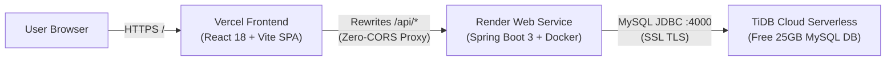

# 🚀 Study Lab: Complete Free Deployment Guide

This guide details how to deploy the entire **Study Lab** full-stack application (Frontend + Backend + Cloud Database) **100% for free** without paying anything or needing credit cards.



---

## 🏗️ Architecture & Free Tier Breakdown

| Component | Platform | Free Tier Specifications | Cost |
| :--- | :--- | :--- | :--- |
| **Database** | **TiDB Cloud (Serverless)** | 25 GiB storage, 50M Request Units/mo, MySQL 8.0 compatible, no credit card required | **$0 / month** |
| **Backend** | **Render** | 512 MB RAM, Web Service (Docker container), auto TLS/HTTPS, automated Git deploys | **$0 / month** |
| **Frontend** | **Vercel** | 100 GB bandwidth, automatic Edge CDN, custom domain support, serverless proxy rewrites | **$0 / month** |

---

## 📍 Step 1: Provision Free MySQL Cloud Database (TiDB Cloud)

Since your project uses `mysql-connector-j` with Spring Data JPA entities, the best free cloud database is **TiDB Cloud Serverless** (fully MySQL-compatible, free forever, no expiration, no credit card required).

1. Go to [tidbcloud.com](https://tidbcloud.com) and click **Sign Up** (using GitHub or Google).
2. Choose **Serverless** (Free forever).
3. Name your cluster: `studylab-db`.
4. Choose the region closest to you (e.g., `AWS / us-east-1` or `AWS / ap-south-1`).
5. Click **Create**. Within ~15 seconds, your cluster is live!
6. Click **Connect** → choose **Connect with Java (JDBC)**.
7. Note down your credentials:
   - **Host**: e.g., `gateway01.us-east-1.prod.aws.tidbcloud.com`
   - **Port**: `4000`
   - **Database**: `test` (or create database `stddb` in SQL console)
   - **Username**: e.g., `xxxxxxxx.root`
   - **Password**: `YourGeneratedPassword`
   - **JDBC URL**:
     ```
     jdbc:mysql://<HOST>:4000/<DATABASE>?sslMode=VERIFY_IDENTITY
     ```

> **Automatic Table Creation**: Because your backend has `spring.jpa.hibernate.ddl-auto=update`, Spring Boot will automatically create all tables (`user`, `course`, `course_content`, `enrollment`, `learning_progress`, etc.) in TiDB as soon as it boots up!

---

## 📍 Step 2: Deploy Backend on Render

Render will build and run your Spring Boot application using the provided multi-stage `Dockerfile`.

### 1. Push Your Code to GitHub
Make sure your project repository is committed and pushed to GitHub:
```bash
git add .
git commit -m "Add Dockerfile and deployment configurations"
git push origin main
```

### 2. Create Web Service on Render
1. Go to [render.com](https://render.com) and sign in with GitHub.
2. Click **New +** → **Web Service**.
3. Select your repository: `onlineCourseManagementSystem`.
4. Fill in the deployment details:
   - **Name**: `studylab-backend` (or a name of your choice)
   - **Region**: Choose the same region as your database (e.g., US East / Ohio)
   - **Environment**: **Docker** (Render will automatically detect the root `Dockerfile`)
   - **Instance Type**: **Free** ($0 / month, 512 MB RAM)
5. Scroll down to **Environment Variables** and add the following keys:

| Key | Value | Description |
| :--- | :--- | :--- |
| `SPRING_DATASOURCE_URL` | `jdbc:mysql://<YOUR_TIDB_HOST>:4000/<DB>?sslMode=VERIFY_IDENTITY` | TiDB Cloud JDBC connection string |
| `SPRING_DATASOURCE_USERNAME` | `<YOUR_TIDB_USERNAME>` | Cluster root username |
| `SPRING_DATASOURCE_PASSWORD` | `<YOUR_TIDB_PASSWORD>` | Cluster password |
| `SPRING_JPA_HIBERNATE_DDL_AUTO` | `update` | Automatically creates JPA tables |
| `SPRING_MAIL_USERNAME` | `bhargavbala56@gmail.com` | Gmail for notification alerts |
| `SPRING_MAIL_PASSWORD` | `hluu yotl hqsb vrnb` | Gmail 16-character App Password |

6. Click **Deploy Web Service**.
7. Wait 2-3 minutes for Maven to compile the JAR and start the container.
8. When the logs display `Started OnlineCourseManagementSystemApplication in X seconds`, your backend is live!
9. Copy your assigned public URL:
   ```
   https://studylab-backend.onrender.com
   ```

> **Render Free Tier Spin-Down**: After 15 minutes of inactivity, Render's free tier spins down the backend. The first request after sleep takes ~40-60 seconds to wake up (cold start). Subsequent requests respond instantly.

---

## 📍 Step 3: Configure Frontend & Deploy on Vercel

### 1. Update `frontend/vercel.json` with your Render URL
Open `frontend/vercel.json` and replace `YOUR_RENDER_BACKEND_URL` with your actual Render service name:

```json
{
  "version": 2,
  "rewrites": [
    {
      "source": "/api/(.*)",
      "destination": "https://studylab-backend.onrender.com/$1"
    },
    {
      "source": "/(.*)",
      "destination": "/"
    }
  ]
}
```

> **Why this prevents CORS**: When the browser sends requests to `https://your-frontend.vercel.app/api/courses`, Vercel proxies it directly to `https://studylab-backend.onrender.com/courses` at the server level. The browser considers it same-origin, completely eliminating CORS errors without modifying any backend Java code!

### 2. Deploy on Vercel
1. Go to [vercel.com](https://vercel.com) and sign in with GitHub.
2. Click **Add New...** → **Project**.
3. Import your GitHub repository: `onlineCourseManagementSystem`.
4. In the configuration screen:
   - **Root Directory**: Click **Edit** and select **`frontend`**
   - **Framework Preset**: **Vite** (detected automatically)
   - **Build Command**: `npm run build`
   - **Output Directory**: `dist`
5. Click **Deploy**.
6. Within ~30 seconds, Vercel will deploy your React app to a public URL:
   ```
   https://studylab-xxxx.vercel.app
   ```

---

## 📍 Step 4: Verification Checklist

1. **Open Frontend URL**: Visit `https://your-app.vercel.app`. Verify that the homepage loads with the **Study Lab** branding and **Black Mode** toggle button.
2. **Register a Student Account**:
   - Go to `/register` and sign up with your email.
   - Verify that you receive the welcome email notification from Gmail SMTP.
3. **Register an Instructor Account**:
   - Register as an `INSTRUCTOR`. The account will be marked `PENDING`.
4. **Approve via Admin**:
   - Log in as `admin@example.com` (`password123`).
   - Open `/admin/dashboard` → Go to **Pending Instructors** → Click **Approve**.
5. **Create & Learn**:
   - Log back into the approved instructor account and publish a course with video/PDF lessons.
   - Switch to the student account, enroll in the course, and launch the **Study Lab** classroom!

